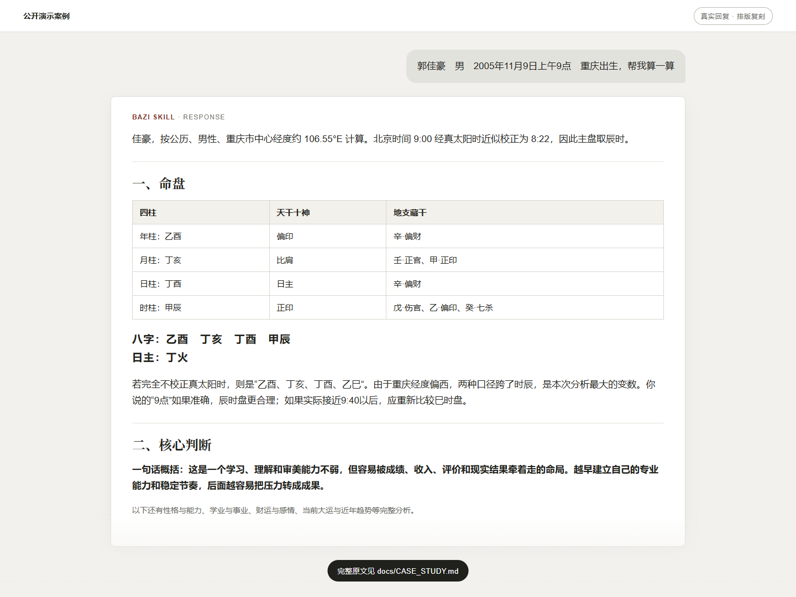
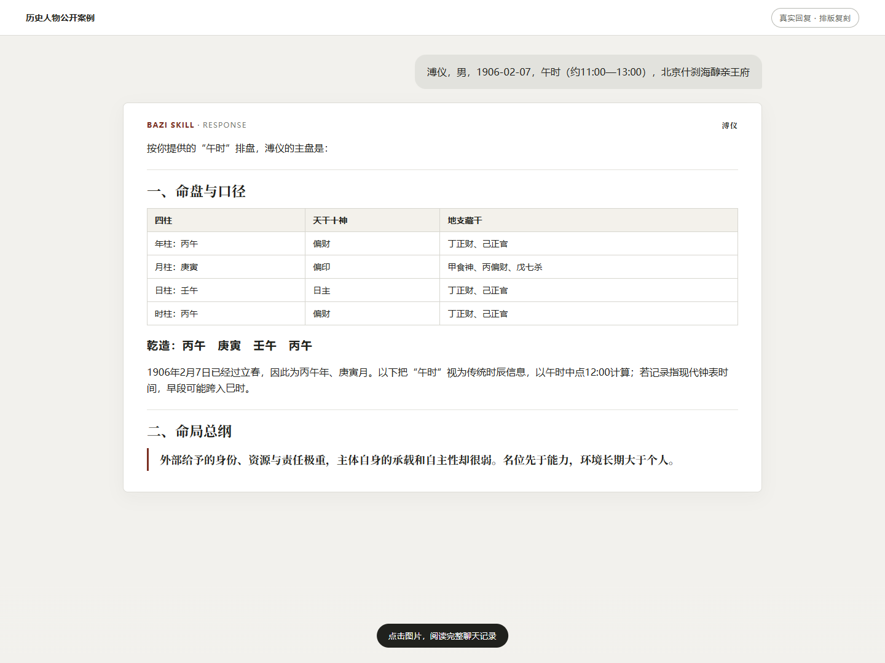
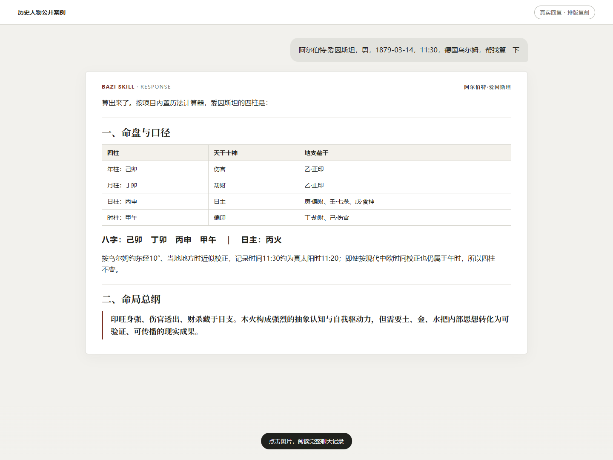
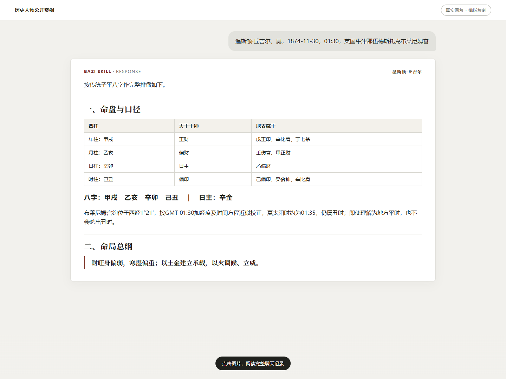

# 八字研判（Bazi）Codex Skill

一个把**确定性四柱排盘**、**可追溯的传统命理规则**和**证据优先的咨询表达**分开的 Codex 技能。

它不是一段把所有知识塞在一起的提示词：历法事实由 Python 计算器负责，领域知识按问题加载，模型负责综合、反证和不确定性说明。

> 八字属于传统文化解释体系，不是科学预测。本项目适合文化研究、方法实验与娱乐参考，不应替代医疗、法律、财务或其他专业判断。


## 项目亮点

| 能力 | 说明 |
|---|---|
| 确定性排盘 | 计算四柱、十神、藏干、五行概况、大运、流年与主要干支关系 |
| 明确计算口径 | 显式记录立春换年、节令换月、晚子换日和真太阳时校正 |
| 按需推理 | 按事业、财运、关系、健康、年份事件等问题加载对应规则 |
| 反证校准 | 区分盘面事实、结构判断、条件性推断与现实建议 |
| 可回归验证 | 计算器有自动测试；评测流程与可安装技能隔离，避免答案泄漏 |
| 安全表达 | 不编造经历，不把倾向写成必然，不用灾祸、疾病等表述制造恐惧 |

## 快速体验

### 在 Codex 中使用

将 [`bazi-skill-main/`](bazi-skill-main/) 复制到你的 Codex skills 目录并命名为 `bazi`，重新打开 Codex 后即可调用：

```text
请用 $bazi 分析：公历 1990-05-15 14:30，女性。
我只关心未来两年的职业变化，请先说明排盘口径，再给证据、反证和现实建议。
```

更完整的安装、提问方式和目录说明见 [`bazi-skill-main/README.md`](bazi-skill-main/README.md)。

### 直接运行排盘器

项目已内置 `lunar_python 1.4.8`，无需另外下载依赖：

```powershell
python .\bazi-skill-main\scripts\calculate_bazi.py `
  --date 1990-05-15 `
  --time 14:30 `
  --gender female `
  --target-year 2026 `
  --compact
```

输出为结构化 JSON。上述示例会得到四柱 `庚午 辛巳 庚辰 癸未`，并同时返回所采用的历法口径、起运信息及 2026 年的岁运关系。

## 真实演示：不是只给一个结论

下面不是概念海报，而是项目作者提供的真实提问与回复内容的排版复刻。排盘器先把北京时间 `09:00` 校正为近似真太阳时 `08:22`，再得到主盘四柱 `乙酉 丁亥 丁酉 甲辰`。由于校正前后跨越时辰边界，回答把“辰时还是巳时”列为最大不确定来源，而不是悄悄选择一个口径。

[](docs/CASE_STUDY.md)

完整案例展示了这条路径：

```text
出生信息 → 确定性排盘 → 传统结构判断 → 最强反证 → 现实建议
```

点击上图或查看 [`docs/CASE_STUDY.md`](docs/CASE_STUDY.md)，阅读完整真实回复，并了解计算事实、传统解释和现实边界如何在同一份回答中分开呈现。

## 更多公开案例

以下案例均保留真实提问与完整回复。**点击图片即可进入对应的聊天记录。** 历史节点仅用于事后结构校验，不能证明命理具有科学预测能力。

### 溥仪：名位、承载与时代裹挟

[](docs/cases/puyi.md)

### 阿尔伯特·爱因斯坦：抽象体系与现实验证

[](docs/cases/einstein.md)

### 温斯顿·丘吉尔：现实压力、组织与公共表达

[](docs/cases/churchill.md)

## 工作方式


这个分层有两个目的：计算结果可以独立测试，命理解释也不会伪装成计算事实。

## 仓库结构

```text
.
├─ bazi-skill-main/       可直接安装的技能包
│  ├─ SKILL.md            技能入口与任务路由
│  ├─ README.md           安装、使用与开发说明
│  ├─ scripts/            排盘器、测试与内置依赖
│  ├─ references/         计算口径、推理协议、领域规则与示例
│  └─ agents/             Codex 界面元数据
├─ evaluation/            隔离的评测记录、工具与最终报告
├─ docs/                  展示与讲解材料
├─ CONTRIBUTING.md        修改与验证约定
└─ LICENSE                项目许可证
```

[`evaluation/`](evaluation/) 故意放在技能包之外。Benchmark 题目、答案、历史预测和误差分析不得进入可安装目录。

## 验证与评测

运行计算器回归测试：

```powershell
python -m unittest -v .\bazi-skill-main\scripts\test_calculate_bazi.py
```

当前 5 项测试覆盖独立排盘 fixture、目标年份与大运、晚子换日、真太阳时方向、原局关系层。

项目还保留了选择题评测，但数字需要谨慎解读：

- MingLi-Bench 160 题开发兼容评测：`85/160 = 53.125%`。
- BaziQA Celebrity50 预登记保留集：`53/57 = 92.98%`。
- 后一个子集答案分布偏斜且题面常有强文本线索，不能把高分归因于命理能力；专家审查层相对直答多数票的净增益为 `0`。

实验设计、冻结版本和限制见 [`evaluation/final_report.md`](evaluation/final_report.md)。

## 文档导航

- [技能安装与使用](bazi-skill-main/README.md)
- [三分钟演示指南](docs/SHOWCASE.md)
- [公开演示案例](docs/CASE_STUDY.md)
- [公开案例合集](docs/cases/README.md)
- [评测协议](evaluation/README.md)
- [最终评测报告](evaluation/final_report.md)
- [参与开发](CONTRIBUTING.md)
- [第三方依赖说明](bazi-skill-main/THIRD_PARTY_NOTICES.md)

## License

项目采用 [MIT License](LICENSE)。内置第三方代码的许可证见 [`THIRD_PARTY_NOTICES.md`](bazi-skill-main/THIRD_PARTY_NOTICES.md)。

## 联系与交流

如果你对 Skill 的使用、排盘口径、证据化回答方式或项目协作有想法，欢迎通过微信交流。添加时请备注 `Bazi Skill`。

<p align="center">
  
</p>
