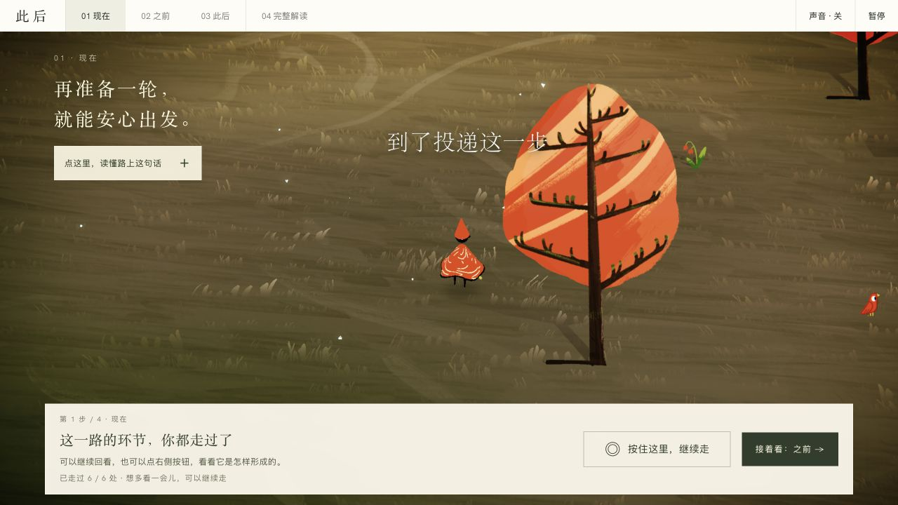
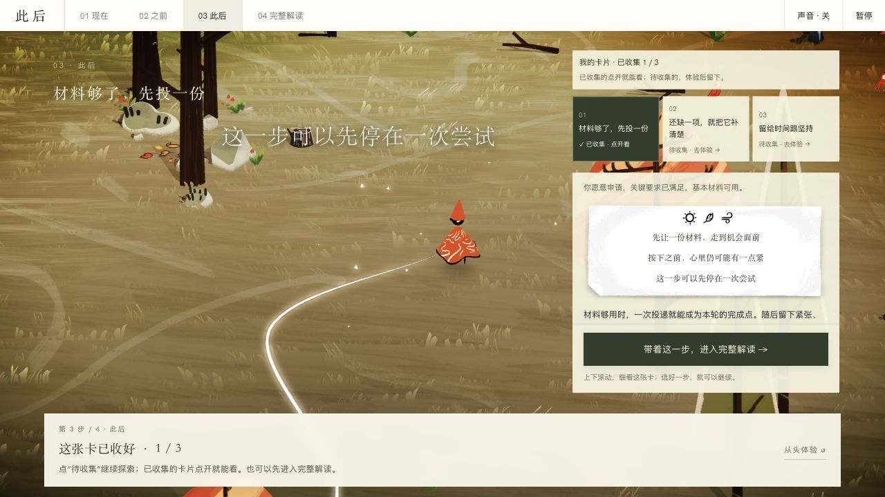
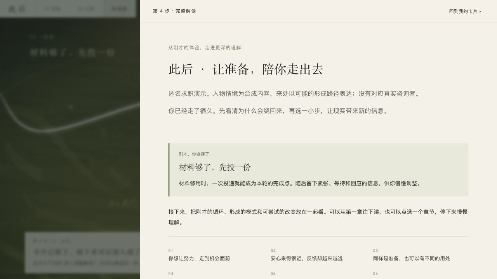

# Afei Destiny Skill · 阿飞命运探索

**把四柱分析、反馈对话与一份可以漫游的个人报告连接起来的 Codex Skill。**

A Codex skill for Bazi / Four Pillars exploration, reflective dialogue, and interactive personal reports.

[](https://github.com/guojiahh/afei-destiny-skill/actions/workflows/validate.yml)

[看演示](docs/SHOWCASE.md) · [安装使用](afei-destiny-skill/README.md#安装) · [项目地图](docs/WORKSPACE_GUIDE.md) · [参与开发](CONTRIBUTING.md) · [English overview](#english-overview)



*当前 V21 的真实界面截图，内容为合成求职案例。画面复用 Wayfinder，原作与素材归属见[致谢与来源](afei-destiny-skill/assets/cihou/quiet/wayfinder/PROVENANCE.md)。*

## 你会得到什么

一次从出生信息与现实问题开始的对话，以及最终可以在本地打开的 **`final_report.html`**。报告中的「此后」体验用四步引导阅读：

| 现在 | 之前 | 此后 | 完整解读 |
|---|---|---|---|
| 按住行走，看见当下如何循环 | 按住回看，一种应对怎样逐渐形成 | 点一个选择，得到对应行动卡 | 带着这一步，深入阅读九章正文 |

**选一项就能得到一张卡并进入正文。** 另外两张可以继续收集；已得卡点开直读，只有主动点“重播”才再次播放。每份报告的循环、形成路径与行动来自本次资料，求职只是演示中的一个主题。

<table>
  <tr>
    <td></td>
    <td></td>
  </tr>
  <tr>
    <td align="center">选一次，留下一张可以回看的卡</td>
    <td align="center">从体验走进完整解读</td>
  </tr>
</table>

[更多桌面与手机截图、操作说明 →](docs/SHOWCASE.md)

## 三分钟开始

### 先看报告

无需安装 Skill：[下载 V21 匿名演示 HTML](https://github.com/guojiahh/afei-destiny-skill/raw/refs/heads/main/design-demos/cihou-wayfinder-v21/final_report.html)，保存后用现代浏览器打开。文件约 **68 MB**，包含场景素材和正文；首次加载需稍等。[演示说明与构建资料](design-demos/cihou-wayfinder-v21/README.md)。

GitHub 的文件预览不会运行交互页面。已克隆仓库时，也可以按[本地预览步骤](docs/SHOWCASE.md#本地打开)体验。当前提供本地 HTML，私有在线托管、账号与跨设备同步尚未实现。

### 安装并开始自己的探索

1. 获取仓库：

   ```sh
   git clone --depth 1 https://github.com/guojiahh/afei-destiny-skill.git
   cd afei-destiny-skill
   ```

2. 只安装里面的 **`afei-destiny-skill/`** 目录。默认目标是 `~/.codex/skills/afei-destiny-skill/`，首层应直接有 `SKILL.md`。运行环境为 Python **3.9–3.13**，计算依赖已内置。[macOS / Linux / Windows 复制命令与自检](afei-destiny-skill/README.md#安装)。

3. 在新的 Codex 会话中调用：

   ```text
   请用 $afei-destiny-skill 开始预测，一步一步带着我分析。
   ```

技能会确认出生资料与关注方向，计算并审计盘面，先锁定盲测再接收反馈，随后围绕一个现实主问题深入。完整咨询会从本次底稿生成个人 HTML；也可以只问职业、关系或某一年，不必每次生成长报告。

### 只想运行排盘器

从仓库根目录执行；Windows 将 `python3` 换成 `python`：

```sh
python3 afei-destiny-skill/scripts/calculate_bazi.py --date 1990-05-15 --time 14:30 --gender female --target-year 2026 --compact
```

输出为 JSON。此示例四柱为 **庚午 辛巳 庚辰 癸未**，2026 流年为丙午，同时返回计算口径、起运和岁运关系。[参数与时间边界说明](afei-destiny-skill/README.md#直接使用计算器)。

## 项目怎样工作

| 层次 | 职责 |
|---|---|
| 确定性计算 | Python 负责历法、四柱、大运与流年，显式记录节气和换日口径 |
| 按需分析 | Codex 按问题加载规则，分开支持证据、反证与现实建议 |
| 可恢复咨询 | 每次会话独立记录阶段与来源；出生信息纠正后，旧盘和下游结论失效 |
| 可阅读交付 | 双 Markdown 底稿 → 来源绑定模型 → 交互 HTML，正文、依据和底稿下载同页可用 |

盲测判断在反馈前锁定，用户后来提供的经历不会倒写成命盘事实。Benchmark 与真实咨询均隔离于技能包。功能与回归可检查；传统命理的解释效力并未因此得到科学证明。

> 八字属于传统文化解释体系。本项目用于文化研究、方法实验与自我观察；重要决定仍应依据现实信息和专业意见。

## 在哪里继续

**这是一个研发仓库，真正可安装的部分只有 `afei-destiny-skill/`。**

| 你想做什么 | 入口 |
|---|---|
| 安装、提问、升级或使用计算器 | [Skill 使用说明](afei-destiny-skill/README.md) |
| 看截图、体验报告 | [演示与截图](docs/SHOWCASE.md) |
| 了解文件职责、找到实现 | [工作区地图](docs/WORKSPACE_GUIDE.md) |
| 继续开发当前 V21 | [当前版本与交接](docs/CIHOU_HANDOFF.md) |
| 检查评测方法和实际结果 | [评测实验室](evaluation/README.md) · [方法报告](docs/EVALUATION_AND_ITERATION_METHOD.md) |
| 查找其他文档和历史设计 | [文档索引](docs/README.md) · [设计演示索引](design-demos/README.md) |

评测记录按原轮次保留。最近一次保留集结果没有证明准确率提高，详情见[迭代报告](evaluation/competition-iterations/iteration_report.md)；不把选择题得分包装为现实预测能力。

## 参与与反馈

欢迎通过 [Issues](https://github.com/guojiahh/afei-destiny-skill/issues) 提交安装、计算或交互问题，或发起改进建议。**请勿在公开问题中提交出生资料、私人咨询或含答案的缓存。**

开发环境和修改约定见 [CONTRIBUTING.md](CONTRIBUTING.md)。准备好 Python 与 Node 后，在仓库根目录运行：

```sh
python tools/check_workspace.py
```

修改 Skill 还需 `--skill` 结构校验。GitHub Actions 对 macOS、Windows、Linux 运行同一检查入口。

## 来源、许可证与致谢

项目自有代码和文档采用 [MIT License](LICENSE)。**第三方运行时、美术、字体、音频和视频保留各自许可证与权利，不由本项目的 MIT 许可覆盖。** 详细清单见[第三方说明](afei-destiny-skill/THIRD_PARTY_NOTICES.md)。

- [lunar_python](https://github.com/6tail/lunar-python)：确定性历法计算，内置版本 1.4.8，MIT。
- [Wayfinder](https://wayfinder.nfb.ca/)：当前交互报告复用的原作，Matt DesLauriers 与 NFB 制作，Tiffany Beucher 插画、Guillaume Le Roux 动画与三维。[素材、补丁与权属说明](afei-destiny-skill/assets/cihou/quiet/wayfinder/PROVENANCE.md)。

## English overview

This repository contains an installable Codex skill (`afei-destiny-skill/`), a deterministic Python Bazi calculator, consultation workflows, interactive HTML reports, and a separate evaluation lab. The current Chinese-language demo guides readers through a present loop, possible origins, action cards, and a full report.

Start with the [installation guide](afei-destiny-skill/README.md) or [screenshots and demo](docs/SHOWCASE.md). Python 3.9–3.13 is required; Node is used for development tests. Public examples are synthetic. Third-party Wayfinder assets retain their original rights; see the [notices](afei-destiny-skill/THIRD_PARTY_NOTICES.md).

<details>
<summary>联系与交流</summary>

欢迎交流使用体验、排盘口径或项目协作。微信添加时请备注 `Afei Destiny Skill`。

<p align="center"></p>

</details>
