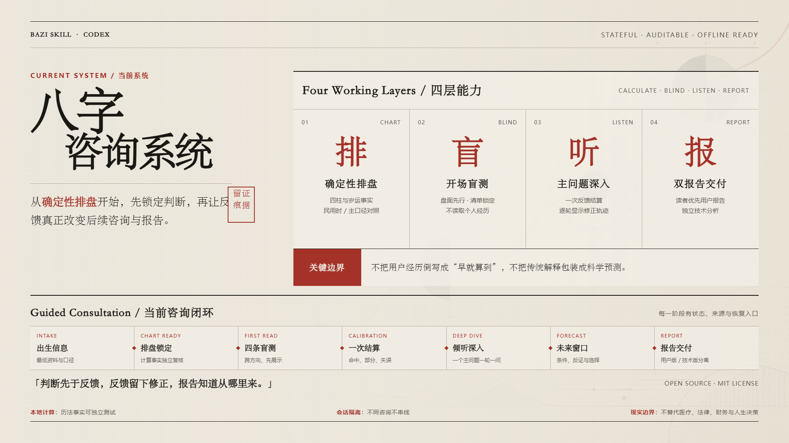
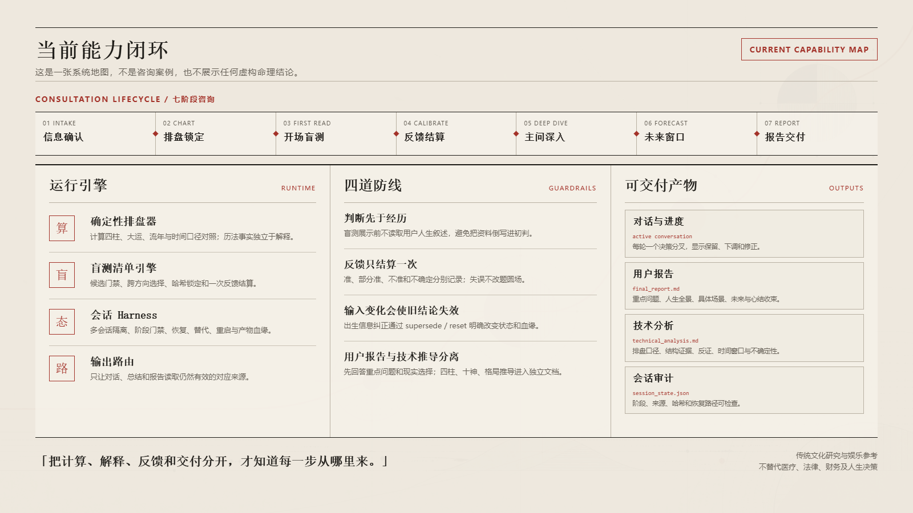

# Afei Destiny Skill · 阿飞命运探索

由 **afei** 发起的命运探索实验，围绕命运、巧合、努力与选择展开对话，让每次探索带来一点新的视角与启发。

当前以 **四柱八字（Bazi / Four Pillars）** 为核心，把**确定性排盘**、**盲测与反馈隔离**、**可恢复咨询状态**和**个人 HTML 交付**连接起来。`Destiny` 是项目的探索主题；当前实现的分析方法与计算能力仍以八字为基础。

它不是一段把所有知识塞在一起的提示词：Python 负责历法事实，规则按问题加载，状态机管理反馈与来源，模型负责综合、反证、不确定性说明和读者优先表达。

> 八字属于传统文化解释体系，不是科学预测。本项目适合文化研究、方法实验与娱乐参考，不应替代医疗、法律、财务或其他专业判断。



## 项目亮点

| 能力 | 说明 |
|---|---|
| 确定性排盘 | 计算四柱、十神、藏干、五行概况、大运、流年与主要干支关系 |
| 明确计算口径 | 显式记录立春换年、节令换月、晚子换日和真太阳时校正；准确出生时间与时间口径敏感性分开处理 |
| 统一咨询入口 | 用户只说“开始预测”也能同时提交出生信息与关注方向，经过完整盘面审计、四到五条盲测、一次结算和倾听式主问题进入报告 |
| 按需推理 | 按事业、财运、关系、健康、年份事件等问题加载对应规则 |
| 结构分层 | 分开判断旺衰、格局组织、调候、病药，以及合冲是否真正改变结构 |
| 反证校准 | 区分盘面事实、结构判断、条件性推断与现实建议 |
| 反馈防污染 | 先锁定盘面判断，再用标注化反馈校准，不把用户经历倒写成命盘事实 |
| 可恢复会话 | 状态机记录阶段、产物哈希与来源；资料纠正会自动使旧盘和下游结论失效 |
| 多会话隔离 | `consultation_state/` 下每次咨询独立成目录；开始时先发现未完成会话，再由用户选择继续或新开 |
| 输出路由 | 对话、技术审计、咨询总结、用户报告和独立技术报告只读取仍有效的对应产物 |
| 个人 HTML 交付 | 沉浸式三态主图聚焦重点，同页阅读九章与技术依据；双 Markdown 作为内部底稿与可选下载 |
| 场景化与心结收束 | 重要判断配具体生活例子、反例和情绪成本；帮助用户看清执念背后的需要与仍有的选择权 |
| 可回归验证 | 计算器有自动测试；评测流程与可安装技能隔离，避免答案泄漏 |
| 安全表达 | 不编造经历，不把倾向写成必然，不用灾祸、疾病等表述制造恐惧 |

## 快速体验

### 在 Codex 中使用

将 [`afei-destiny-skill/`](afei-destiny-skill/) 复制到你的 Codex skills 目录并命名为 `afei-destiny-skill`，重新打开 Codex 后即可调用：

```text
请用 $afei-destiny-skill 开始预测，一步一步带着我分析。
```

如果用户还没有提供出生信息，技能会先完成最小资料收集与关注方向确认；排盘和内部审计后展示默认四条、强信号时五条盲测，用户反馈后只结算一次，再围绕一个现实主问题倾听和深入。明确只问职业、关系或某一年时，也可以直接进入对应主题。

更完整的安装、提问方式和目录说明见 [`afei-destiny-skill/README.md`](afei-destiny-skill/README.md)。

### 直接运行排盘器

项目已内置 `lunar_python 1.4.8`，无需另外下载依赖：

```powershell
python .\afei-destiny-skill\scripts\calculate_bazi.py `
  --date 1990-05-15 `
  --time 14:30 `
  --gender female `
  --target-year 2026 `
  --compact
```

输出为结构化 JSON。上述示例会得到四柱 `庚午 辛巳 庚辰 癸未`，并同时返回所采用的历法口径、起运信息及 2026 年的岁运关系。

在 macOS / Linux 的终端中，使用下面的一行命令：

```sh
python3 afei-destiny-skill/scripts/calculate_bazi.py --date 1990-05-15 --time 14:30 --gender female --target-year 2026 --compact
```

从 Windows 切换到 Mac 的虚拟环境、命令和换行说明见[开发初始化指南](CONTRIBUTING.md#macos--linux-初始化)。

## 当前能力闭环



这张图展示的是当前代码中已经存在的运行引擎、防污染门禁和可交付产物，不是咨询案例，也不包含任何虚构命理结论。

完整流程从出生信息与排盘口径开始，经过盲测前盘面审计、四条开场盲测、一次反馈结算和倾听式主问题，最后以用户解读和技术分析为底稿，生成、校验并登记个人 HTML。每一阶段都有状态、来源和恢复入口；输入被纠正时，旧盘和下游结论会按显式操作失效，而不是静默混用。

仓库暂不展示真实咨询案例。旧案例基于早期的一次性回复流程，已经从当前展示层撤下；以后只有完整走过现行咨询闭环、经过隐私审查并获得公开授权的材料，才会重新进入案例区。

「此后」第一阶段已于 **2026-10-16 完成并获用户确认**。[默认个人 HTML 交付](afei-destiny-skill/references/html-report.md)已接通：咨询代理根据本次有效底稿编排有来源的主图与完整详解，脚本校验、生成并登记离线页面。2026-10-20 的 [V19 匿名求职完整演示](design-demos/cihou-wayfinder-v19/final_report.html)继续复用 [Wayfinder 的原站运行时与资源](afei-destiny-skill/assets/cihou/quiet/wayfinder/PROVENANCE.md)，改为按住沿固定路线行走、松开停下，首景重复六个有来源的循环位置；读者主动切换“此刻／来处／可能”，比较三种有条件的选择。每份新报告按[闭环叙事协议](afei-destiny-skill/references/loop-narrative.md)填写自己的 `loop_story`，用自然的第二人称解释循环与可能的形成路径，文字随景色平滑浮现；V19 沿用 V18 文案，集中修复首次加载时的浮字定位；原作资源、正文与双底稿下载都包含在单份 HTML 中。所有新完整报告仍统一三态与九章正文，双底稿固定为八节／十一节。困局的具体解释、事实、行动和未知按本次资料编写；同一个环不代表同一种心理原因。私有在线托管尚未实现。新上下文从[交接说明](docs/CIHOU_HANDOFF.md)继续开发，V8 保存基线、[V15 程序绘画探索](design-demos/cihou-wayfinder-v15/final_report.html)、[V16 原站引擎版本](design-demos/cihou-wayfinder-v16/final_report.html)、[V17 固定路线版本](design-demos/cihou-wayfinder-v17/final_report.html)、[V18 自然叙事版本](design-demos/cihou-wayfinder-v18/final_report.html)与旧匿名原型保留为历史对照。

## 仓库结构

先分清一个容易误解的地方：下面这些目录属于**同一个 Git 仓库**，不是多个独立项目。真正可安装的是 `afei-destiny-skill/`；`evaluation/`、`docs/` 和展示目录只服务研发、验证与说明。`.benchmark-cache/` 中可能存在外部题库自己的 Git 元数据，但它们是被忽略的本地依赖缓存，不属于本项目源码。

```text
.
├─ AGENTS.md              Agent 接手项目时的最小规则与验证入口
├─ afei-destiny-skill/       可直接安装的 Skill；运行时只需要这一层
│  ├─ SKILL.md            技能入口与任务路由
│  ├─ README.md           安装、使用与开发说明
│  ├─ scripts/            排盘器、测试与内置依赖
│  ├─ references/         计算口径、推理协议、领域规则与示例
│  └─ agents/             Codex 界面元数据
├─ evaluation/            与 Skill 隔离的评测实验室
│  ├─ competition-iterations/  2010–2025 比赛轮次与不可变证据
│  └─ archive/            上一代 MingLi/BaziQA 实验归档
├─ docs/                  工作区说明、方法报告和演示指南
├─ assets/                项目主视觉、社交预览、能力图和联系图片
├─ design-demos/          匿名产品原型、历史演示与展示图源稿
├─ dist/                  本地生成的发布压缩包；ZIP 不进入 Git
├─ tools/                 工作区开发检查；不属于可安装 Skill
├─ requirements-dev.txt   开发校验依赖
├─ .github/workflows/     跨平台自动验证配置
├─ CONTRIBUTING.md        修改与验证约定
└─ LICENSE                项目许可证
```

[`evaluation/`](evaluation/) 故意放在技能包之外。Benchmark 题目、答案、历史预测和误差分析不得进入可安装目录。

第一次进入仓库，建议先看 [工作区地图](docs/WORKSPACE_GUIDE.md)。它说明每个目录是什么、哪些是源文件、哪些是生成物，以及改不同功能时应该从哪里开始。

## 验证与评测

按[开发初始化指南](CONTRIBUTING.md)准备 Python 环境后，从仓库根目录运行统一检查：

```text
python tools/check_workspace.py
```

该入口运行两组回归测试、环境自检、空白检查和 Markdown 本地文件链接检查。
修改 Skill 时再加 `--skill`，调用本机安装的 `skill-creator` 结构校验器。

回归检查覆盖历法与口径边界、开场盲测锁定、会话发现与来源隔离、报告固定结构、莫比乌斯模板初始化、占位符与空内容拒绝、来源失效、HTML 注入防护和历史兼容。评测管线另检查题包脱敏、锁定、防篡改、污染隔离和配对比较。实际数量以检查输出为准，避免文档计数随开发失效。

项目保留了两代选择题评测，但数字需要谨慎解读：

- 当前主线是 2010–2025 历届比赛 515 题错题循环。一次性保留集上，旧版为 `70/160 = 43.75%`，最终版为 `71/160 = 44.38%`；命例级 bootstrap 区间跨 0，因此本轮**没有证明准确率提高**。
- 上一代 MingLi/BaziQA 实验已经冻结并移入 [`evaluation/archive/mingli-baziqa/`](evaluation/archive/mingli-baziqa/)。其中 MingLi-Bench 开发兼容分为 `85/160 = 53.125%`；BaziQA 的高分子集存在答案分布和文本线索偏差，不能解释为命理预测能力。

完整方法见 [评测与迭代方法报告](docs/EVALUATION_AND_ITERATION_METHOD.md)，本轮实绩见 [2010–2025 迭代报告](evaluation/competition-iterations/iteration_report.md)。

## 文档导航

- [工作区地图：每个目录和文件是什么](docs/WORKSPACE_GUIDE.md)
- [此后：当前原型与新对话交接](docs/CIHOU_HANDOFF.md)
- [评测与迭代方法报告](docs/EVALUATION_AND_ITERATION_METHOD.md)
- [知识与推理缺口审计](docs/KNOWLEDGE_AUDIT.md)
- [文档总索引](docs/README.md)
- [技能安装与使用](afei-destiny-skill/README.md)
- [三分钟演示指南](docs/SHOWCASE.md)
- [评测实验室索引](evaluation/README.md)
- [2010–2025 比赛轮次索引](evaluation/competition-iterations/README.md)
- [上一代 MingLi/BaziQA 评测归档](evaluation/archive/mingli-baziqa/README.md)
- [参与开发](CONTRIBUTING.md)
- [第三方依赖说明](afei-destiny-skill/THIRD_PARTY_NOTICES.md)

## License

项目采用 [MIT License](LICENSE)。内置第三方代码的许可证见 [`THIRD_PARTY_NOTICES.md`](afei-destiny-skill/THIRD_PARTY_NOTICES.md)。

## 联系与交流

如果你对 Skill 的使用、排盘口径、证据化回答方式或项目协作有想法，欢迎通过微信交流。添加时请备注 `Afei Destiny Skill`。

<p align="center">
  
</p>
