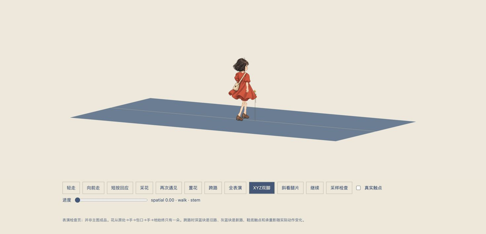

# RigV13 空间脚约束契约与制作检查

这是在 take01 证明脚跳 / 漂移后新增的修复版本；不是独立设计评分，也不是组合主图验收。

[hero-character-rig-v13.js](../../../afei-destiny-skill/assets/cihou/quiet/immersive/hero-character-rig-v13.js) 新增原生 XYZ 两骨 IK 和纵向纸片蒙皮。冻结 RigV12 没有覆盖，角色 PNG / metadata 没有改动。几何回归时 SHA256 为 `f65df591c4d62bc15f8313fd30682b3c0833b8da21b814e6729ce10aaf4b12ce`；随后仅追加 pelvisSink / spatialPelvisAdjustment 被动数值，当前 SHA256 为 `11f6389407b73df0ccd5f8613d7b2cac85a08a2ce08f544e6e7ace52094f23cf`，联合验证前仍可能修复。

## 与 SceneV13 的唯一接口

```js
rig.update(gaitSeconds, speed, {
  feetTargets: {
    left:  { x, y, z, stance, angle: 0 },
    right: { x, y, z, stance, angle: 0 }
  }
});
```

- 全局 `CihouCharacterRigV13`；`version=13`，`isV10/isV12/isV13=true`。
- XYZ 是 **unmirrored rig-local 的实际 alpha 鞋底支撑地标**，不是踝、投影像素或假附件深度。scene 将真实 world 锚直接交给 `rig.group.worldToLocal`；不再次乘 facing。
- `feetTargets` 为左右 object；保留旧 `footTargets` 别名。外部目标优先于动作内部脚位，scene 的 `stance∈[0,1]` 是权威负重，不再与角色事件的额外 footLoads 相乘。
- 对 swing 同样执行 XYZ IK；可以给真实抬脚 Y / Z、stance=0。只有 scene 的逐脚状态机负责换锚，不由 rig 自行推进时间。
- `angle` 是局部 XY 鞋底 pitch，默认 0。固定目标使用中性 alpha 鞋底地标随 angle 旋转，避免最低像素在滚跟 / 趾间切换。源 alpha 支撑点不假设为推算踝。
- `getFootContacts()` 返回真实渲染 alpha 地标的 `x/y/z/stance`，并增加 `ankleZ/heelX/heelZ/toeX/toeZ`；`getAttachment(side+'Foot')` 为同一点。
- 两腿 actual XYZ 踝共同约束骨盆高度；不移动脚、不把整个纸偶向镜头偏置。水平不可达会在 `getActionState().legReachability` 中明确返回 `overreach` 和 `reachable=false`，不能据此宣称无过伸。
- `getGaitMetrics` 继续采用 `.170→.270H`、duty `.62`、clock `.92Hz`；scene 继续以完整实际 world 距离换 gait，不只乘 screen-X 投影。
- cross 的 rootTravel 和安全点不变。actor 根位移仍只由 scene 执行一次；已经 worldToLocal 的 feetTargets 不再减一次 rootTravel。

髋 → 膝、膝 → 踝使用三维两骨解；原画腿片沿骨中心线变形，踝部权重过渡到真实鞋平面 Z。躯干 / 头 / 手 / 包纸片仍在原来的平面，depthTest 保留。

## 修正真实绘画接触点

旧 RigV12 的 hand 附件 Z `.020` 和包口附件 Z `.018` 高于真实纸片；不能把附件到花的 0m 写成真实手绘像素接触通过。

RigV13 不移动手片来迎合旧数字，而是从实际变形后 mesh 的 UV 三角形重心坐标采样 `handPx` 与 `bagOpeningPx`，再应用 mesh 的实际 scale / quaternion / position：

| 地标 | 原 PNG 像素 | alpha | 实际局部绘画 Z |
| --- | --- | ---: | ---: |
| 左掌 | 1150,438 | 253 | .0048 |
| 右掌 | 1476,433 | 253 | 0 |
| 包口 | 584,250 | 253 | .004 |

这些点在原 PNG 中分别是肉色掌点和米色包口。手与包的 `.0008` 深度差来自原纸片层次，不是外加 `.014–.020` 的浮层。SceneV13 按实际附件深度动态求花前 lane / 落花点，不写死旧 `.020`。拾 / 收 / 放花归属阈值仍保持不变。

## 真实演员页验证

[空间演员页](actor-spatial-preview.html) 使用原生三维地面，点击“XYZ双脚”把两只鞋置于不同深度，再点击“斜看腿片”实际观察连接。默认 Chrome，无 viewport 覆盖；真实 JPEG / DOM 为 1470×710，站高约 188px。



[rig13-geometry-results.json](rig13-geometry-results.json) 为点击公开“采样检查”后从实际 DOM 保存的原文。额外的 301 组 XYZ / 动作组合由独立的 UV 三角形读取函数检查真实 mesh，而非只相信 getFootContacts 附件：

- 实际鞋底 alpha mesh 到目标最大误差 `2.17e-8`。
- 手绘掌点与 hand 附件最大误差 `6.75e-9`；真实包口为 `6.23e-9`。
- 301 组可达目标的腿过伸为 `0`；源支撑点 alpha 最小 `33`。
- 故意给出不可达水平目标时，`legReachability` 能报告失败。
- 原 1001 步态和 804 动作样本非有限顶点为 `0`。

这些只是角色几何与接口回归。**尚未以此记录证明 SceneV13 的真实世界 stance、动作过渡、坡面 / 高视角可达性、真实花交接或手机已通过。** 下一次联合 take 必须再次记录实际鞋底 UV mesh 的 world 轨迹、固定锚按当前 camera 的像素重投影、scene 足影锚与脚的关系；应分别报告平脚支撑、滚动、phase 边界、不可达和最坏值。
