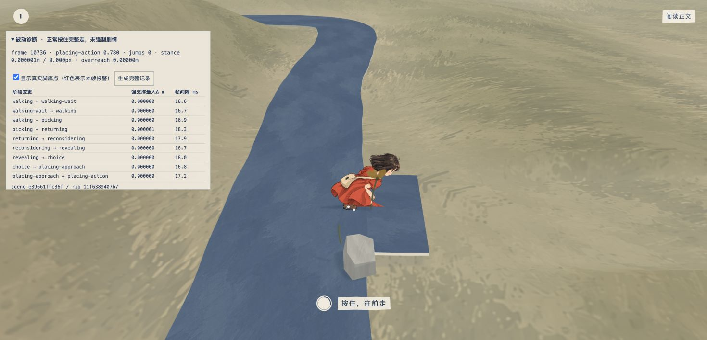
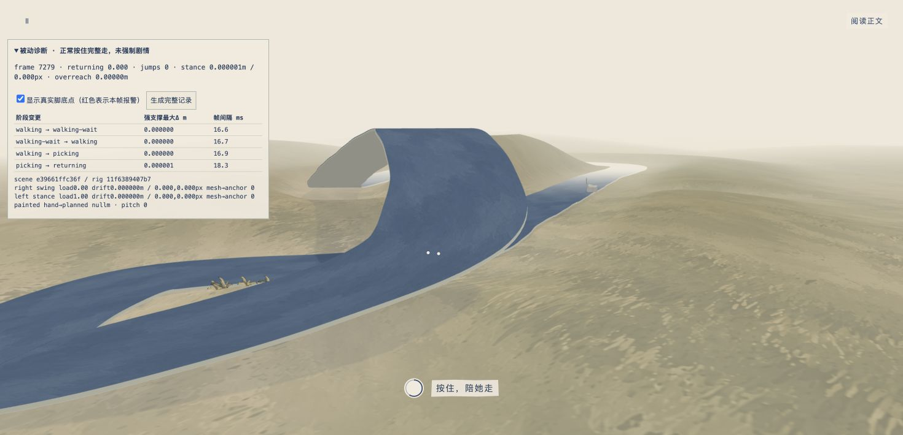
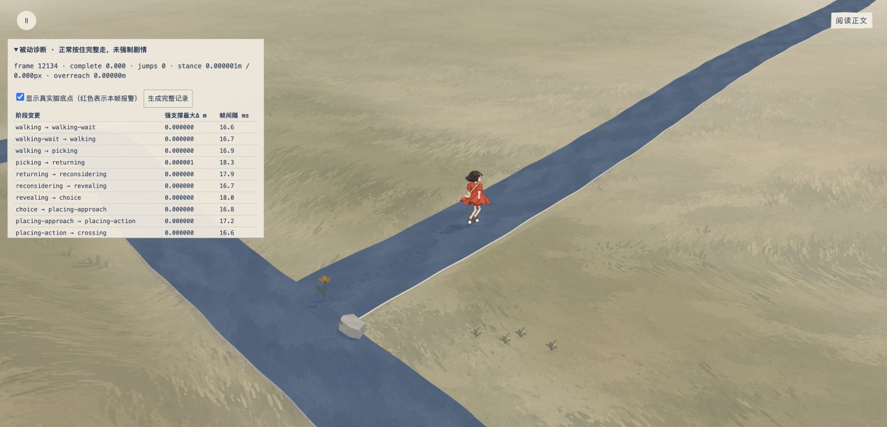

# RigV13 / SceneV13 真实完整 take01

这是制作专项验证，不是独立设计评分，也不覆盖之后的 40Hz 积分版本。SceneV13 在本 take 后仍继续修桥下机位、低帧步序与植被。

## 加载版本与过程

[被动诊断页](transition-preview-v13.html) 保留原型公开控制器；正常 native 长按 / 释放走完整圈、再次遇见、回望、出路、放花、跨步和 complete。没有 seek、force phase、修改时钟或脚目标的浏览器命令。最后实际点击“暂停动画”和“生成完整记录”，从可见 DOM 取回原文。

[源码记录](transition-v13-take01-source.json) 固定以下字节快照：

| 文件 | SHA256 |
| --- | --- |
| [SceneV13 快照](scene-snapshot-v13-take01.js) | `e39661ffc36f73295daf053d23821a25e6d185c1a4c4430a7e5298b98ec29b15` |
| [RigV13 快照](rig-snapshot-v13-take01.js) | `11f6389407b73df0ccd5f8613d7b2cac85a08a2ce08f544e6e7ace52094f23cf` |
| 原型公开控制器 | `3a7fb38dfc71ab27ad100e01be201331cfe6e35f4e3817d2293fbcf09bb8f960` |

[当时诊断源代码](transition-diagnostics-v13-take01.js)、[原始记录](transition-v13-take01-raw.json)、[离线分相位分析](transition-v13-take01-analysis.json) 均保留。实际为 12,497 帧、209.1747 场景秒。Chrome 1 独占输入，测试标签已经关闭；没有改 / reset viewport。8 张 JPEG 的真实像素均为 **1470×710**。

## 真实渲染取样方法

脚的位置不只读取 `getFootContacts()`。诊断独立寻找 alpha 源像素所在的 indexed UV 三角形，按重心坐标读取这一帧真正的 geometry position，再应用 mesh 和 group 的实际 scale / quaternion / position，得到渲染的鞋底材料点 world XYZ。手与包也用独立 UV 三角读取真实绘画掌点和包口。

每个强支撑窗口保存其首帧真实 world 点作为固定锚，后续 **用当前 camera 重新投影这个固定锚**，和本帧真实鞋底像素比较 X / Y 偏差。足影同时读取，但足影与鞋重合没有被当作足部稳定的证明。强支撑为 `stance>=.75 && planner.mode==='stance'`；相邻帧报警要求间隔不超过 80ms。

## 落脚结果

- 强支撑相邻帧大于 0.03m 的跳位：**0 次**。
- 强支撑累计 world 漂移最大 `0.000001m`；当前相机下像素偏差最大 `0.000112px`（X `0.000110px` / Y `0.000099px`）。这些量已接近记录中 world XYZ 保留 6 位小数产生的误差，不能解读为精确到微米的物理测量。
- 独立真实 UV 鞋底 → rig 附件 / scene 计划锚的误差，按 6 位小数记录均为 `0m`。
- 本次所有实际帧的两腿 `overreach=0`。额外沉髋峰值必须同时披露：returning `0.080629m`（time97.6619、travel45.634981），revealing `0.025797m`，crossing `0.048708m`，placing approach `0.037427m`。不能只报告“腿可达”隐藏这项代价。
- 外部 XYZ 目标使用固定中性 alpha 鞋底地标和 `angle=0`，没有旧版本最低像素在 heel / toe 间切换的伪跳位。平常 heel→toe 的 world Y 差为 0；revealing 纸偶适量俯仰时峰值 `0.002518m`。

| 实际阶段边界 | 同一只脚前后都强支撑的最大 Δ m | 帧间隔 ms |
| --- | ---: | ---: |
| walking → picking | 0 | 16.9 |
| picking → returning | .000001 | 18.3 |
| returning → reconsidering | 0 | 17.9 |
| reconsidering → revealing | 0 | 16.7 |
| revealing → choice | 0 | 18.0 |
| choice → placing approach | 0 | 16.8 |
| placing approach → placing action | 0 | 17.2 |
| placing action → crossing | 0 | 16.6 |
| crossing → leaving | 0 | 15.9 |
| leaving → complete | 0 | 16.6 |

这验证了固定 alpha 支撑点，尚不是整个鞋底轮廓与每一处坡面法线完全吻合的证明。下一次新积分 / 镜头 take 将追加真实 road mesh 射线检查，不用改脚目标来迎合诊断。

## 真实掌点与唯一花

归属切换实际 progress：pick `.433658/.863974`，reconsider `.083375/.942188`，place `.203778/.780000`。连续渲染帧自然可能略晚于代码阈值。

- stem → hand：真实绘画掌点 → 固定花握点 `0m`，同一花握点帧间位移 `.000001m`。
- place hand → ground：真实掌点 → 固定地面花握点 `0m`，帧间位移 `0m`。
- 手 / 包切换花握点帧间变化 `.000801–.001680m`，其中手与真实绘画包口层次相差 `.0008m`；不是旧版本假的 `.018/.020` 悬浮附件。

放花 `.780` 的实帧：

## 明确未通过的视觉点

**travel58.349793m 的桥下实帧，女孩被上方桥面全部挡住。** 页面仍正常渲染，白点只是被动诊断层，不能用它们冒充女孩可见。已交给场景工程师修真实相机 / 路桥可见性；此 take 不能作为整段视觉验收通过。

[截图记录](transition-v13-take01-screenshots.json) 逐项注明截图中可见 frame 对应的真实 phase / 时间。取花和回望高机位的截图因为工具往返已经错过动作峰值，所以文件明确命名为 after-pick / before-reconsider / after-reveal，不冒充峰值图；峰值数值仍由连续每帧原始记录覆盖。下次应在同一次浏览器调用中等可见诊断文本进入阶段，立即截图。

complete+5.0981s 的末镜女孩名义站高 `83.2px`；这是实际拍到的时间，未称 +3.2–4.5s。它仍继续轻走，不是强制冻结终点。

当前 SceneV13 后续修改了 40Hz simulation 和桥下相机，这份快照的 0 漂移结果不会自动延伸到新版本。后续常规 / 低帧真实浏览器回归仍待完成。
