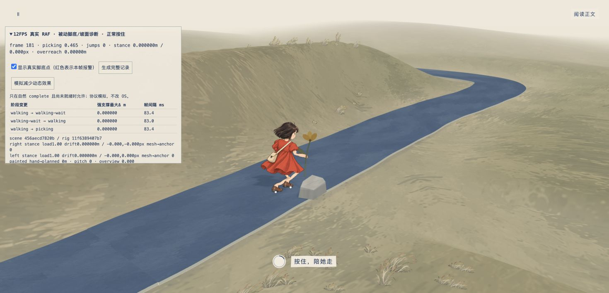
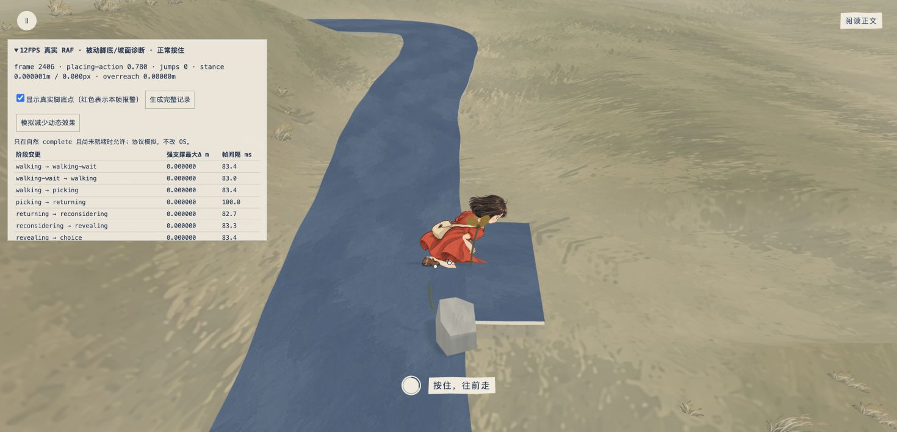
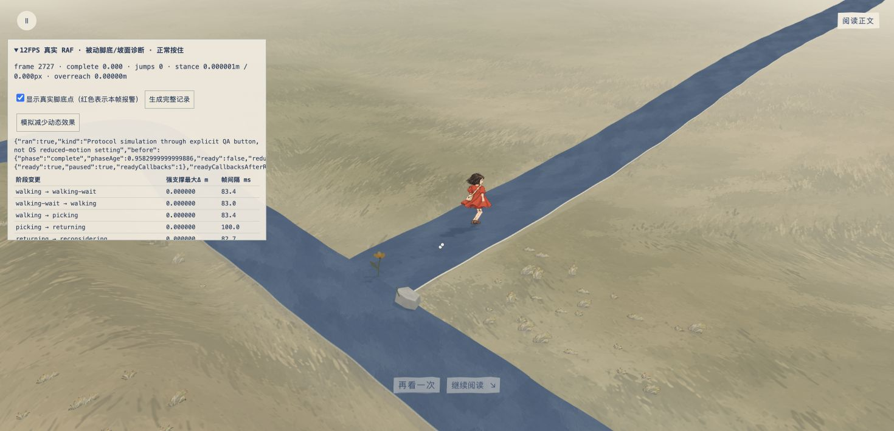

# 冻结 V13 低帧完整 take02：未通过

这是制作验证，不是设计评分。沿正常 UI 完整行走、拾花、回望、选择出路、放花、跨步并自然到 complete；没有强制剧情进度。原生 RAF 回调经过明确的低帧 QA 门，应用时间、速度和落脚目标没有被重写。

## 冻结输入与原始证据

[QA 页面](transition-preview-v13-lowfps.html)、[加载记录](transition-v13-take02-source.json)、[原始 DOM JSON](transition-v13-take02-raw.json)、[分析 JSON](transition-v13-take02-analysis.json)、[最坏值完整取样](transition-v13-take02-extremes.json) 均保留。

| 输入 | SHA256 |
| --- | --- |
| [Scene13](scene-snapshot-v13-take02.js) | `456aecd7820be88f7d357ccf6b2265e6dc1bd7a09dcabd21d9ebd9863eaab0f3` |
| [Rig13](rig-snapshot-v13-take02.js) | `11f6389407b73df0ccd5f8613d7b2cac85a08a2ce08f544e6e7ace52094f23cf` |
| 原型控制器 | `812eabb0f7110d6bc629e09c37d218a9f70998c55f03cbb7ba88440edfe01c13` |
| [被动观察器](diagnostics-snapshot-v13-take02.js) | `61183ad3ca179190611b958b83e812680a06ad9faae66cbfc76b53ddf9dda8a0` |
| [原生 RAF 低帧门](raf-cadence-v13-take02.html) | `cf92d10637e283248e01d40ae3de978255d7a3dc5093b0a18ce096a16e3f301b` |

2,728 真实观察帧，235.5812 场景秒，实际约 11.58FPS；相邻回调中位数 83.4ms、p95 100ms、最大101ms。为容纳真实低帧间隔，本次相邻强支撑报警上限明确改为250ms；不使用旧60FPS take的80ms上限把所有低帧帧排除。默认 Chrome，未设置 viewport，JPEG 实际1470×710。标签已关闭。

## 单点支撑保持，但不能据此验收身体与鞋形

实际鞋底 alpha UV 材料点仍由独立 indexed mesh 三角形采样，固定世界锚通过当前 camera 重投影；不是足影贴鞋证明。

- 最大强支撑 world 漂移 `0.000001414m` / 像素偏差 `0.000142px`，真实 mesh→计划锚记录为0（6位小数精度）。
- 大于3cm的强支撑相邻跳位0；12个阶段边界已覆盖。
- 旧planner在cross时把后脚mode标成swing，即使它仍承重且未抬。另以权威 `stance>=.75` 不看mode重审所有原始 world 点：[独立负重审计](transition-v13-take02-authoritative-load-audit.json)，最大漂移仍为 `0.000001414m`，大于3cm事件0。新诊断按负重判断强支撑，保留mode作说明。
- 真实绘画掌点取花 / 放花握点误差0；放花实际`.780`抓到实图。

## 阻断一：跨步额外沉髋24.7cm

最大 `spatialPelvisAdjustment=.247159m` 出现在 crossing `p=.664550`、time229.9145、travel68.713828、exitDistance.218237；俯角权重0、腿overreach0。returning本身的最大额外沉髋仍为`.078416m`，大峰集中于跨步后脚拖留原锚阶段。

| 实际点 | world XYZ | 负重 / mode |
| --- | --- | --- |
| actor root | `[-2.202960,.117303,-.989230]` | — |
| right alpha sole | `[-2.235208,.121304,-.915393]` | 1 / stance |
| left alpha sole | `[-1.990973,.121301,-1.242992]` | .280868 / swing（仍在旧rear start） |

后脚离root约.33m，再叠加真实鞋底→踝偏移、髋宽，后腿水平伸距逼近腿长。此时root transfer已经接近结束，后脚却要等`.67`才follow；零overreach是沉髋求解得到，不能把它当成自然姿势通过。

原始take未保留该极值帧的actor quaternion和局部踝目标，未把重建值冒充实测。下次诊断会直接保留极值帧完整rig state、局部目标与actor变换。

## 阻断二：斜坡鞋轮廓真实穿坡3.16cm

被动Raycaster读取**真实road / exit mesh三角形**，每3个观察帧，对强支撑鞋的源alpha底轮廓、heel、toe和support取样。没有以曲线解析高度代替真实mesh，也没有把高桥误当脚下地面（射线从鞋上方.30m向下，选择邻近鞋高度的实际三角交点）。以下最坏值来自承重鞋，不是摆腿低点。

time106.9814 / travel46.260874，左鞋：

| 真实材料点 | 鞋Y | 同XZ真实路面Y | clearance |
| --- | ---: | ---: | ---: |
| alpha底像素540,934 | 1.143346 | 1.174964 | **-.031618m** |
| heel | 1.146695 | 1.177420 | -.030725m |
| support | 1.140412 | 1.141823 | -.001410m |
| toe | 1.146695 | 1.138527 | +.008168m |

这说明：单点footplant保持，但`angle=0`的鞋沿并未随坡面方向适配。support另有约1.4mm的曲线点与620段实际mesh近似差。不能整体抬鞋3cm来使最低值好看；应从真实mesh锚 / 法线给现有外部sole angle，再回测真实alpha轮廓。

另只读核对原PNG：最坏alpha底像素540,934的alpha为102，heel527,931为210，toe655,924为248；不是仅alpha33的微弱散边制造3cm报警。support636,932恰为alpha33边缘，这进一步说明不能只看一个支撑地标。

## 静默终态的减少动态效果协议

自然到达complete+`.9583s`、`presentationReady=false`后，实际点击公开QA按钮“模拟减少动态效果”。按钮明确走 `scene.reducedMotion=true; scene.setPaused(true)`，重复pause检查幂等；不改OS设置，也不强制complete。

[可见DOM结果](v13-take02-reduced-protocol.json)：ready立即true，ready callback一次；重复pause后仍一次，passed=true。

这张图证明协议就绪，**不证明新的静态脚部姿势**：暂停时sceneTime不再变化，旧被动鞋点叠层没有再次更新，白点可留在旧帧位置。

## 截图局限与后续

桥中心58.21m和overview峰值截图仍因调用往返错过，不冒充截到。`after-underpass`实际已到travel64.148m，`after-reveal`为choice；连续原始数值记录覆盖整个阶段。场景工程师另有fresh390桥前 / 中 / 后实图；root会在正式适配器再实际体验。

上述候选已经冻结，独立critic09尚未启动。修复使用新Scene14 / Rig14，不覆盖这里的原始证据。约定最小cross变更为rear follow`.40→.67`，与root transfer同步，保留front / press / rootTravel总量 / `.40,.67,1`安全点；坡面使用现有外部angle和真实mesh锚。仍需实际联合take验证。
