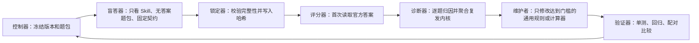

# 比赛做题、评测与错题迭代方法报告

版本：1.0

日期：2026-08-10

适用对象：本地 Bazi Skill + 固定 Codex 模型的命理比赛选择题

## 一、这套评测究竟要提高什么

本阶段优化的不是模糊的“预测整个人生准确率”，而是一个可以核对的窄目标：

> 给定比赛题面、命盘信息和选项，在不读取答案的前提下，提高“具体年份 + 具体事件”选择题与官方答案键的 exact-match 命中率。

必须同时保留三条边界：

1. **比赛答案一致性不等于现实真相。** 官方答案是比赛评分目标，不天然是真实世界的客观标签。
2. **传统命理判断不等于科学预测。** 这套循环可以检验系统是否更会做一批固定题，不能证明命理具有科学效度。
3. **旧题提高不等于泛化提高。** 题目答案一旦揭晓，它只能用于训练与防回退；真正的最终成绩必须来自新题。

因此需要分开报告四种能力：

| 能力 | 怎么测 | 能证明什么 |
|---|---|---|
| 确定性计算 | 单元测试、独立 fixture、边界测试 | 排盘和岁运计算是否按约定执行 |
| 比赛选择题 | 锁定后 exact-match | 与该比赛答案键的一致性 |
| 推理稳定性 | 跨案例错因、配对 wins/losses、置信度 | 规则是否可重复、是否更少随机猜 |
| 真实预测能力 | 需要独立、前瞻、可核验现实结果的研究设计 | 当前比赛循环不能单独证明 |

## 二、当前数据状态

2010–2025 共 16 届、107 个案例、515 题，最初按完整年份和完整案例切分：

| 分区 | 年份 | 案例 / 题数 | 原用途 | 现在的状态 |
|---|---|---:|---|---|
| 开发集 | 2010–2017 | 41 / 195 | 揭晓、归因、修改 | 已暴露 |
| 配对回归集 | 2018–2021 | 34 / 160 | 旧版和候选版同时锁定后比较 | 已揭晓，转为回归池 |
| 一次性保留集 | 2022–2025 | 32 / 160 | 最终候选冻结后只揭晓一次 | 已耗尽 |

现在全部 515 题都已暴露。接下来的正确定位是：

- 用 515 题反复训练、做错因聚合和防回退；
- 把新一届尚未揭晓的比赛题作为真正的最终考试；
- 旧题上的任何涨分只能叫“训练拟合提高”或“回归分提高”。

## 三、角色分离

同一个模型可以承担不同角色，但一次运行中必须分开上下文和权限。



| 角色 | 可以读取 | 禁止读取/操作 |
|---|---|---|
| 控制器 | 含答案缓存、协议、Git 状态 | 不替盲答器暗示答案 |
| 盲答器 | 冻结 Skill、单年 `questions.json`、`solver_prompt.md` | 缓存、分数、旧预测、网页、Git 历史、其他代理输出 |
| 锁定器 | manifest、题包、预测、Skill | 不允许缺题、重复题或覆盖已锁预测 |
| 评分器 | 锁定预测、官方答案 | 锁定前不得运行 |
| 诊断器 | 错题、答案、作答证据、规则 | 不得为了单题直接写补丁 |
| 维护者 | 聚合后的 recurrence 证据、源代码 | 不写人物专属事实、题号、答案字母或分布技巧 |
| 验证器 | 新旧版本和暴露回归池 | 不把回归分冒充新盲测分 |

这里的隔离是“可审计白名单”，不是操作系统级硬隔离：Codex 子代理共享工作区文件系统，公开题也可能存在于模型预训练材料中。因此报告只能说“按协议限制了输入”，不能说“绝对无污染”。

## 四、正式循环

完整循环不是“先做几道、看到错就随手改”，而是以下 12 步：

### 1. 冻结目标

在作答前写清楚：

- 数据集和年份；
- 这些题属于训练、回归还是新保留集；
- 模型名称和推理强度；
- Skill Git commit 与内容哈希；
- 固定 solver prompt 与协议哈希；
- 主指标、次指标和“怎样才算提高”。

任何一项中途变化，都必须新开轮次，不能混进原轮次。

### 2. 导入题目

含答案的标准化数据写入 Git 忽略区：

```powershell
python evaluation/import_competition_questions.py --years 2010:2025
```

导入后检查：案例数、题数、每题选项是否合法、答案键是否属于选项、原始来源是否完整。数据问题单独记录，不允许让模型“脑补正确答案”。

### 3. 生成无答案题包

`prepare` 只通过字段白名单写出盲答需要的信息，并删除：

- 官方答案；
- 高亮或排除标记；
- 来源 URL、排盘 URL；
- 可回查作者和身份标识；
- 任何上一轮分数或错因。

同时生成 manifest，记录题包、Skill、协议和提示词 SHA-256。

### 4. 审计

`audit` 检查三类问题：

- 题包是否含禁用字段；
- Skill、协议或提示词是否在 prepare 后被修改；
- manifest 是否如实记录污染和 Git 状态。

只要盲答上下文见过答案、高亮、旧预测或身份回查信息，就要在 `contamination` 中登记；污染轮不能进入正式结果。

### 5. 用干净上下文作答

盲答器从新上下文开始，只读取：

1. 指定的冻结 Skill；
2. 指定年份的 `questions.json`；
3. `evaluation/solver_prompt.md`。

每个问题输出：答案、置信度、第二候选、计算状态，以及 1–3 条能在揭晓前审计的决定性事实。不保存隐藏思维链。

### 6. 完整性校验并锁定

锁定前检查：

- 每个题号恰好出现一次；
- 没有额外题号；
- 答案字母属于该题选项；
- 置信度在合法范围；
- Skill 和题包哈希未变化。

`lock` 写入预测哈希和不可覆盖副本。锁定之后不能“改一两个答案再评分”。

### 7. 揭晓与评分

只有所有计划中的版本都锁定后，控制器才读取答案。旧版与候选版做配对实验时，必须先把两者都锁定，再一起揭晓。

### 8. 逐错题根因分析

每道错题只指定一个主因，按固定顺序判断，避免把所有问题都含糊写成“推理不好”：

1. `data_issue`：题面、答案键或标准化数据有问题；
2. `option_parse`：否定词、复合子句或选项边界读错；
3. `calculation`：排盘、大运、流年或关系矩阵算错；
4. `knowledge_gap`：当前体系确实缺少必要的通用知识；
5. `reasoning_error`：事实算对，但裁决顺序、权重或事件映射错；
6. `execution_error`：规则已有却没有执行、漏调用工具或漏比较候选；
7. `unresolved`：信息不足，无法诚实定位到前六类。

再记录一个次因，例如：`luck_cycle`、`timing`、`compound_option`、`option_negation`、`base_rate`、`uncalibrated_guess`。

### 9. 聚合复发内核

诊断的重点不是复述“这题选 B 才对”，而是寻找可以跨人物、跨年份复用的 recurrence key，例如：

- 复合选项没有逐子句检查，某个弱子句本应否决整项；
- 醒目的合冲刑害压过了主体、领域和阶段；
- 从结构倾向越级跳到具体死亡、疾病、职位或婚期；
- 候选年份没有用同一组指标完整比较；
- 否定题把“命盘看不出来”误写成“现实没有发生”；
- 换运年按整年选了单一大运，忽略具体日期边界。

每个内核必须附带题数、独立案例数、代表性证据和一个反事实：如果当时应用新规则，是否真会改变选择？

### 10. 通过修改门槛

允许改动的情况只有两类：

| 类型 | 最低证据 | 额外要求 |
|---|---|---|
| 确定性计算 bug | 1 个可复现错误 | 必须新增失败前红、修复后绿的测试 |
| 规则/推理改动 | 同一内核至少 3 题、跨至少 2 个独立案例 | 必须是通用规则，且写明可能副作用 |

禁止的改动：

- 写入具体人物经历；
- 写入题号、原选项或官方答案字母；
- 根据答案 A/B/C/D 分布调参；
- 为一道错题创造只适用于它的口诀；
- 用八字规则冒充当前 Skill 没有实现的紫微斗数模块。

没有达到门槛时，正确动作是保留 `unresolved` 或继续积累，不是强行解释。

### 11. 分层验证

改动后依次运行：

1. Skill 结构验证；
2. 计算器单元测试；
3. 评测状态机与防泄漏测试；
4. 已暴露 515 题的回归；
5. 新旧版本逐题配对审计；
6. 最后才碰仍未揭晓的新保留集。

回归集不是只看总分。候选版多对 20 题、同时多错 19 题，与净增 1 题是完全不同的产品含义；前者说明规则正在大幅换票，必须查交互副作用。

### 12. 写报告并提交 Git

每轮提交应同时包含：

- 冻结协议/manifest；
- 锁定预测和分数；
- 结构化错因；
- 规则或代码修改；
- 新增测试；
- 新旧配对结果；
- 诚实结论和适用边界。

不提交缓存中的答案和原始网页，也不提交本地发布 ZIP。

## 五、每一道题具体怎么做

盲答器对每个案例先建“共享盘面事实”，再逐题做六行决策卡。题与题之间可以复用已核验计算事实，但不能把上一题猜测当作人物经历。

### 第 0 步：判断能不能算

- 输入是否包含足够出生信息；
- 题目使用的是八字还是其他体系；
- 时辰、历法口径、大运方向是否明确；
- 若体系超出能力，标记 `calculation_status: blocked` 并降低置信度，不能伪造计算。

### 第 1 步：拆解选项

把每个选项拆成必要子句。`A：结婚并在 2019 年生子` 是两个都必须成立的断言；只支持“结婚”不能选 A。

对否定题先圈出“不是、没有、不可能、不符合”等逻辑方向，防止选反。

### 第 2 步：锁定主体、领域、阶段

明确题目问的是谁、什么领域、什么时间段：本人/父母/配偶/子女，学业/事业/财运/关系/健康，原局/大运/流年/具体日期。主体或阶段不匹配的证据不能直接迁移。

### 第 3 步：先算确定性事实

需要时调用本地脚本核验：

```powershell
python .\bazi-skill-main\scripts\calculate_bazi.py --date 1990-05-15 --time 14:30 --gender female --target-year 2026 --compact
```

候选年份必须同尺度比较，不能只深挖最显眼的一年：

```powershell
python .\bazi-skill-main\scripts\compare_candidate_years.py --help
```

检查四柱、节令、起运、当前大运、流年干支、作用对象、合冲刑害及换运边界。计算事实与命理解释分开记录。

### 第 4 步：整体功能链

判断事件需要的链条是否完整，例如资源、表达、职位、财富、关系对象和承载条件是否同时存在。单个合、冲或一个十神不能一次证明多个具体经历。

### 第 5 步：粒度与基准率

选项越具体，所需证据越多。具体死亡、癌症、坐牢、高级官职、精确婚期等属于高负担断言；不能因为“有压力信号”就越级。

基准率只能在命理证据相近时破平，不能代替盘面证据，也不能偷用人物身份或真实履历。

### 第 6 步：主动找最强反证

对当前首选问：

- 哪个必要子句最弱？
- 是否把“可发生”写成“必发生”？
- 是否有另一个选项被同一事实更直接支持？
- 是否把不可识别误判成未发生？
- 是否有时辰、换运日或体系不匹配的不确定性？

反证足以击穿首选时，换票；否则保留首选但校准置信度。

### 输出格式

```json
{
  "answer": "A",
  "confidence": 0.55,
  "alternative": "C",
  "calculation_status": "verified",
  "decisive_facts": [
    "候选年处于已核验的大运，且直接引动题目所问的关系接口",
    "其他选项包含没有独立证据支撑的高负担子句"
  ]
}
```

置信度不是“语气强度”。`blocked`、跨体系、低可识别现实细节或多个选项接近时，置信度应明显降低。

## 六、指标和判定规则

### 主指标

**Exact-match micro accuracy**：答对题数 / 总题数。它直接对应比赛名次，但会让题多的案例权重更大。

### 必须同时报告的指标

| 指标 | 用途 |
|---|---|
| case macro accuracy | 每个命例先算准确率再平均，避免大案例支配结果 |
| per-year accuracy | 查年份难度和数据漂移 |
| paired delta | 同一题候选版减旧版，消除题目组成差异 |
| wins / losses / ties | 看净增背后有多少换票和回退 |
| case-level bootstrap 95% interval | 评估增益是否可能只是案例抽样波动 |
| Wilson 95% interval | 给单版本准确率合理区间 |
| top-label Brier | 检查自报置信度是否校准 |
| root-cause counts | 判断真正的瓶颈在哪里 |
| deterministic test results | 防止推理涨分掩盖计算退化 |

### “提高了”的严格门槛

只有同时满足以下条件，才写“准确率提高”：

1. 在预先锁定的新保留集上候选版配对差值为正；
2. 命例级 bootstrap 95% 区间不跨 0；
3. 没有严重计算回归、泄漏或污染；
4. 变化不是由答案分布、人物身份或题面漏洞驱动。

否则用更准确的表述：

- “训练集拟合提高”；
- “回归集出现正向趋势，但区间跨 0”；
- “校准改善，exact-match 持平”；
- “没有证明提高”。

## 七、当前一轮告诉了我们什么

2010–2025 闭环的最终保留集结果：

| 版本 | 命中 | 准确率 |
|---|---:|---:|
| 旧版 v1 | 70/160 | 43.75% |
| 最终版 v3 | 71/160 | 44.38% |

候选版相对旧版：19 题由错变对、18 题由对变错、123 题持平；净增 `+1`，即 `+0.63pp`。命例级 bootstrap 95% 区间为 `−6.25%` 到 `+7.50%`，跨 0。

因此本轮正式结论是：

- 规则修改改变了不少具体选择，但正负几乎抵消；
- 置信度校准略有改善；
- exact-match 基本持平；
- **没有证据证明准确率已经提高。**

这不是循环失败，而是一次有效的否证：它阻止我们把开发集涨分包装成泛化能力。具体证据见 [2010–2025 迭代报告](../evaluation/competition-iterations/iteration_report.md)。

## 八、接下来如何继续迭代

### A. 用 515 题做训练和内核提炼

下一轮不再追求“旧题盲分”，而是：

1. 汇总所有错题的 recurrence key；
2. 先攻高频、跨年份、跨案例的推理内核；
3. 为计算类问题补测试；
4. 每次只改一个可解释的规则簇；
5. 对全部 515 题做配对回归；
6. 审查 wins/losses，避免总分不变但行为失控。

建议优先级：

1. 可复现计算与换运边界；
2. 复合选项和否定题逻辑；
3. 主体/领域/阶段路由；
4. 候选年份同尺度比较；
5. 从结构到具体事件的粒度控制；
6. 低可识别题的校准，而不是硬猜成高置信度。

### B. 新比赛发布时做真正验收

新题出现后：

1. 立即保存原始题，答案单独进入控制器缓存；
2. 在任何调试或网页高亮暴露答案之前生成无答案包；
3. 冻结当前 Skill 为 baseline；
4. 如果还要训练，只能使用旧 515 题；
5. 冻结最终 candidate；
6. baseline 与 candidate 都完成锁定后才揭晓新题；
7. 只对这批新题作一次正式泛化判断。

新题量若太小，即使多对一两题也很可能不显著。此时应报告原始题数、配对变化和区间，不夸大百分点。

## 九、可复现命令

### 测试

```powershell
python -m unittest -v .\bazi-skill-main\scripts\test_calculate_bazi.py
python -m unittest -v .\evaluation\test_competition_pipeline.py
```

### 防答案泄漏

```powershell
python evaluation/benchmark_tools.py leak-check `
  --skill bazi-skill-main `
  --sources .benchmark-cache/global-fortune-competition/contest_2010.json
```

正式全量检查时把所有年份源文件传给 `--sources`。

### 单轮状态机

下面以一个新年份为例。必须先确认它的 split 和数据状态：

```powershell
$year = 2026
$round = "evaluation/competition-iterations/$year-v1-baseline"
$input = ".benchmark-cache/global-fortune-competition/contest_$year.json"

python evaluation/competition_iteration.py prepare `
  --input $input `
  --round-dir $round `
  --skill bazi-skill-main `
  --model gpt-5.6-sol `
  --reasoning-effort high `
  --split holdout `
  --prompt-file evaluation/solver_prompt.md `
  --protocol-file evaluation/competition_protocol.json

python evaluation/competition_iteration.py audit `
  --round-dir $round `
  --skill bazi-skill-main

# 盲答器只读取 questions.json、冻结 Skill 和 solver_prompt.md，写 predictions.json。

python evaluation/competition_iteration.py lock `
  --round-dir $round `
  --predictions "$round/predictions.json" `
  --skill bazi-skill-main

# 确认所有计划版本均锁定后，控制器才运行 reveal。
python evaluation/competition_iteration.py reveal `
  --input $input `
  --round-dir $round
```

### 新旧版本配对比较

```powershell
python evaluation/competition_iteration.py compare `
  --base evaluation/competition-iterations/2026-v1-baseline `
  --candidate evaluation/competition-iterations/2026-v2-candidate `
  --output evaluation/competition-iterations/2026-v1-v2-comparison.json
```

## 十、每轮结束检查表

- [ ] 数据用途在作答前已经写明；
- [ ] 模型、推理强度、Skill、提示词和协议均已冻结；
- [ ] 盲答器没有读取缓存、旧预测、分数、错因、网页或 Git 历史；
- [ ] 每个题号恰好有一个结构化预测；
- [ ] 所有计划版本都在揭晓前锁定；
- [ ] 污染如实写入 manifest；
- [ ] 每道错题只有一个主因，并有可审计证据；
- [ ] 规则改动达到跨题、跨案例门槛；
- [ ] 计算修复有新增回归测试；
- [ ] 同时报 micro、macro、wins/losses、区间和校准；
- [ ] 结论与数据状态一致，没有把旧题回刷写成盲测；
- [ ] 报告、测试和实验原件一起提交 Git。

## 最终原则

这个循环真正要优化的不是“解释错题的能力”，而是“在看答案之前做出更稳定选择的能力”。任何在揭晓后才显得漂亮、却不能跨人物复用或不能在新题上验收的规则，都不算准确率进步。
