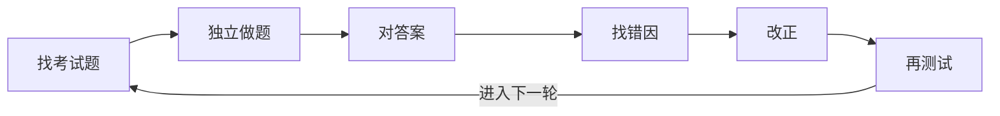

# 真实人物命理赛题：评测与错题迭代方法报告

版本：1.1

日期：2026-08-10

适用对象：第一次接触这个项目的普通观众，以及需要复现实验的项目维护者。

## 先用一句话讲明白

这些比赛题不是电脑随机编出来的，也不是虚构人物题。

**比赛从真实人物和他们已经发生的人生经历中整理案例，再做成选择题。我们先不让 AI 看答案、人物履历和查询线索，让“GPT-5.6 + 本地 Bazi Skill”独立作答；交卷锁定以后才公布答案，错了就分析为什么错，再把可重复的方法教回 Skill。**

所以，观众看到的不是“AI 自己说自己准”，而是一场可以当场判分、可以看到错题、也可以看到它有没有真正进步的考试。

## 一、这个比赛到底在考什么

每个案例背后是一位真实人物。出题方根据人物的出生资料和已经发生的经历，设计若干选项，例如：

- 哪一年出现重要事业变化；
- 某个阶段更可能发生哪类事件；
- 学业、婚姻、家庭或职业经历对应哪个选项；
- 几个具体年份中，哪一个与已发生事件相符。

比赛会公布标准答案。项目以这个答案键判卷，但需要说明：**它代表出题方给出的比赛答案，不等于经过科学实验确认的“人生规律”。**

这套评测真正回答的是：

> 在不知道人物答案和真实履历的情况下，这套 Skill 能不能仅根据题面和命盘信息，更稳定地选中比赛认定的真实经历？

它不是在证明“AI 可以百分之百预测命运”，也不是让 AI 偷看历史人物资料以后倒推答案。

## 二、一张图看懂我们在做什么



这六步会不断循环。每一轮都从真实人物考试题开始，用测试结果决定下一步改什么。

其中最关键的顺序只有八个字：**先答、封卷，再看答案。**

如果先看答案再解释，模型总能编出一套“为什么答案是这个”的说法，但那不是预测能力，只是事后解释能力。

## 三、观众实际会看到什么

一次完整公开演示可以分成七幕：

1. **展示原题。** 告诉观众这是一个真实人物案例，但不公开可供搜索的身份线索和答案。
2. **AI 独立做题。** 它需要给出选择、第二候选、置信度和两三条主要依据。
3. **当场封卷。** 生成锁定记录，证明答案不是揭晓后补改的。
4. **公布标准答案。** 直接显示本题对错，不跳过错题。
5. **打开错题本。** 说明究竟是排盘算错、选项读错、规则缺失，还是判断失误。
6. **展示改动。** 只展示可跨人物复用的改法，不把这个人物的经历背进 Skill。
7. **再次考试。** 先用旧题检查有没有退步，最后用从未见过的新人物题验收。

这比只展示一份漂亮命理报告更有说服力，因为观众可以看到四件事：题是真的、答案提前隐藏、错题没有消失、改进以后还要重新考试。

## 四、每道题是怎么做的

模型不是看到一个“冲”或“合”就直接猜事件。每道题都按下面六步处理。

### 第一步：先看这题能不能算

检查出生时间是否完整、题目用的是八字还是别的命理体系、需要比较的是原局、大运、流年还是某个具体日期。

如果题目明确使用紫微斗数，而当前 Skill 只有八字模块，就必须诚实标记“超出能力范围”，不能拿八字大运冒充紫微大限。

### 第二步：把选项拆开

一个选项可能同时包含两三件事。

例如“在某年结婚，并在第二年生子”其实包含两个必要条件。命盘只支持“关系变化”，并不足以证明整句话成立。

否定题还要先看清楚它问的是“哪个符合”还是“哪个不符合”，防止方向选反。

### 第三步：先用程序核对能确定的部分

四柱、节气、起运时间、所在大运、流年干支和换运日期，优先交给本地计算器，而不是让模型凭印象心算。

这一步相当于考试先把算术题算对。后面的命理解释可以有分歧，但不能建立在排盘错误上。

### 第四步：所有候选放在同一张表里比较

如果题目给出四个年份，就用同样的标准检查四个年份，不能只研究第一眼最显眼的那个。

比较时关注：

- 题目问的是本人、父母、配偶还是子女；
- 问的是事业、关系、健康还是其他领域；
- 哪个年份直接引动这个领域；
- 哪个选项需要额外假设最少；
- 有没有从轻微信号直接跳到严重事件。

### 第五步：检查有没有说过头

“压力变大”不等于一定生病，“关系被引动”不等于一定结婚，“事业变化”也不等于一定升到某个具体职位。

选项越具体、越严重，需要的独立证据越多。癌症、死亡、坐牢、高级官职和精确婚期都属于高负担判断，不能只靠一个醒目的命理关系就下结论。

### 第六步：给首选，也留下不确定性

最终输出不只是一个字母，还包括：

- 首选答案；
- 第二候选；
- 置信度；
- 是否完成了计算核验；
- 一到三条真正区分选项的依据。

这样揭晓以后，我们能知道它是“有依据但判断错了”，还是“不会做却高置信度硬猜”。

## 五、错题不是每题改一条口诀

最危险的训练方法，是看到一道题答案为 B，就给 Skill 加一句只会让这道题选 B 的规则。旧题分数会迅速上升，但它只是背答案。

真正的错题迭代像老师整理全班错题：先找许多人反复出现的共同问题。

| 普通说法 | 具体表现 | 应该怎么处理 |
|---|---|---|
| 题目或答案有问题 | 选项缺失、标准答案无法对应 | 单独标记，不逼模型学习错误数据 |
| 读错题 | 看漏否定词、复合选项只验证了一半 | 改答题检查步骤 |
| 算错盘 | 大运、流年或换运日期算错 | 修程序并补自动测试 |
| 知识确实缺失 | Skill 没有题目需要的通用模块 | 补通用知识，或明确能力边界 |
| 判断顺序错 | 被一个醒目信号带偏，忽略整体 | 改通用裁决顺序 |
| 会但没执行 | 忘了调用计算器、漏比较候选 | 加强执行清单 |
| 暂时解释不了 | 证据不足，无法确认错在哪里 | 保留未知，不编故事 |

### 什么时候才允许修改 Skill

规则很简单：

- **程序算错：**只要能稳定复现一次，就可以修，但必须增加自动测试。
- **判断方法出错：**同一种错误至少出现在 3 道题、2 个不同真实人物案例中，才允许写进通用规则。
- **只错一道：**先记进错题本，不立刻改 Skill。

永远不能写进去的内容包括：人物姓名、真实履历、题号、官方答案字母，以及“这类比赛 B 选项比较多”之类的投机规律。

## 六、怎样知道它是真的进步，而不是背熟旧题

整个题库分成三种用途，可以把它们理解成学生的练习册、模拟考和期末考。

| 通俗叫法 | 用途 | 答案揭晓后还能做什么 |
|---|---|---|
| 练习册 | 找错因、改方法 | 可以反复训练，但只能叫训练成绩 |
| 模拟考 | 检查新方法有没有让旧能力退步 | 可以反复回归，但不再算陌生题 |
| 压轴新题 | 最后检验是否真的能面对新案例 | 只能正式揭晓一次 |

评测时把旧版和新版放到同一批题上比较：

- 旧版答错、新版答对：一次进步；
- 旧版答对、新版答错：一次退步；
- 两版相同：持平。

因此不能只说“新版多对了 19 题”。如果它同时多错了 18 题，真正净提升只有 1 题。

还要估计成绩的“摇摆范围”。如果多换几个真实人物案例，结果可能从提高变成下降，就不能急着宣布准确率提高。

## 七、什么情况下才能对外说“准确率提高了”

必须同时满足：

1. 测试题是修改规则时没有见过的新人物案例；
2. 旧版和新版都在揭晓前完成封卷；
3. 新版净答对更多；
4. 这个增益大到不像是刚好抽题走运；
5. 没有偷看答案、搜索人物履历或利用选项字母分布；
6. 排盘计算和其他题型没有明显退步。

如果只在旧题上提高，应该说“训练成绩提高”。

如果新题上略有提高，但摇摆范围仍可能为零，应该说“出现正向趋势，但还没有证明”。

这种表达看起来更克制，实际上更适合长期营销：观众会知道项目愿意公开失败，而不是每一轮都硬说成功。

## 八、当前这一轮的真实结果

2010–2025 一共有 16 届、107 个真实人物案例、515 道题。

最后一次压轴测试使用 2022–2025 的 32 个案例、160 道题：

| 版本 | 答对 | 答对率 |
|---|---:|---:|
| 修改前的旧版 | 70 / 160 | 43.75% |
| 最终候选版 | 71 / 160 | 44.38% |

细看变化：

- 19 题从错变对；
- 18 题从对变错；
- 123 题没有变化；
- 最终只净增加 1 题。

统计估计的摇摆范围仍跨过“没有提升”这条线。因此正式结论是：

> 这一轮让系统的判断方式发生了变化，置信度也稍微更稳，但比赛答对率基本持平，尚未证明准确率提高。

这不是需要隐藏的坏消息。对观众来说，它反而证明了这套流程不会因为开发题涨分，就自动宣布“AI 已经学会预测命运”。

详细数字和机器记录见[2010–2025 迭代报告](../evaluation/competition-iterations/iteration_report.md)。

## 九、接下来怎么继续

现在 515 道旧题的答案都已经揭晓，它们可以继续作为大型错题本，但不能再假装是陌生考试。

下一阶段分两条线：

### 线一：用旧题练基本功

1. 把 515 题的错误按共同原因重新聚合；
2. 优先修排盘、换运日期和候选年份比较；
3. 再处理复合选项、否定题和判断说过头；
4. 每次只改一个清楚的规则组；
5. 用全部旧题检查哪些变对、哪些退步。

### 线二：等新比赛做真正验收

新比赛一发布：

1. 第一时间保存题目和答案；
2. 在任何人调试答案之前生成无答案版本；
3. 让旧版和最终新版分别独立作答并封卷；
4. 全部封卷后统一公布答案；
5. 对外展示每一道变化题和最终净结果。

只有这批新真实人物题，才能回答“这一轮训练有没有真正迁移到陌生案例”。

## 十、建议怎样把过程拍给普通观众看

一集内容不要先讲文件校验和复杂统计术语。建议顺序是：

1. **开场钩子：**“这是一个真实人物的真实经历题，AI 现在不知道答案，也不能查人物资料。”
2. **展示题面：**让观众自己先猜一个答案。
3. **展示 AI 作答卡：**首选、第二候选、信心和两条依据。
4. **展示封卷：**“现在答案已经锁死，不能改。”
5. **揭晓：**直接显示对错。
6. **错因卡：**用一句人话说明是算错、读错，还是判断过头。
7. **规则改动：**说明这条方法还能帮助哪些别的人物题。
8. **下一题验证：**用另一位真实人物，检查它究竟学会了还是只背了上一题。

可以固定使用下面这张“单题成绩卡”：

| 项目 | 展示内容 |
|---|---|
| 题目来源 | 真实人物比赛案例 |
| AI 首选 | A / B / C / D |
| 第二候选 | 最接近的另一个答案 |
| 信心 | 例如 55%，不要用“肯定” |
| 封卷状态 | 已锁定 / 未锁定 |
| 标准答案 | 揭晓后显示 |
| 错误原因 | 一句话人话总结 |
| 是否改 Skill | 改 / 不改，以及为什么 |
| 下一题结果 | 学会了 / 退步了 / 仍不确定 |

最有营销价值的不是每题都对，而是观众能持续追踪：**它这次错在哪里、究竟改了什么、下一位真实人物身上还管不管用。**

---

# 专业复现附录

下面内容供维护者复现实验。普通观众读到这里可以停止。

## A. 数据状态

| 分区 | 年份 | 案例 / 题数 | 原用途 | 当前状态 |
|---|---|---:|---|---|
| 开发集 | 2010–2017 | 41 / 195 | 揭晓、归因、修改 | 已暴露 |
| 配对回归集 | 2018–2021 | 34 / 160 | 新旧版同时锁定后比较 | 已揭晓，转为回归池 |
| 一次性保留集 | 2022–2025 | 32 / 160 | 最终候选只揭晓一次 | 已耗尽 |

## B. 输入隔离

盲答上下文只允许读取：

1. 冻结的 `bazi-skill-main/`；
2. 单个年份的无答案 `questions.json`；
3. `evaluation/solver_prompt.md`。

禁止读取：`.benchmark-cache/`、网页、旧预测、`score.json`、`error_review.json`、Git 历史、其他作答器输出和人物履历。

这种隔离是可审计的输入白名单，不是操作系统级物理隔离。公开题也可能存在于模型预训练资料中，因此不能声称“绝对无污染”。

## C. 固定状态机

```text
prepare → audit → solve → lock → reveal → diagnose → patch → regression → report → git
```

- `prepare`：删除答案、来源 URL、高亮和回查字段，记录题包、Skill、提示词和协议哈希。
- `audit`：检查禁用字段和 prepare 后的文件变化。
- `solve`：使用新上下文完成全部结构化预测。
- `lock`：验证题号完整性，生成不可覆盖的预测副本和哈希。
- `reveal`：首次读取答案并生成逐题分数。
- `diagnose`：每道错题只指定一个主要原因。
- `patch`：只修改达到门槛的通用规则或确定性计算错误。
- `regression`：运行测试并配对比较新旧版本。
- `report`：同时报告进步、退步、区间和限制。
- `git`：把规则、测试、实验记录和报告放进同一次提交。

## D. 错因代码

固定优先级：

```text
data_issue
→ option_parse
→ calculation
→ knowledge_gap
→ reasoning_error
→ execution_error
→ unresolved
```

每道错题再记录一个次因，例如 `luck_cycle`、`timing`、`compound_option`、`option_negation`、`base_rate` 或 `uncalibrated_guess`。

## E. 指标

| 指标 | 人话解释 |
|---|---|
| exact-match micro accuracy | 总共答对多少题 |
| case macro accuracy | 先算每个人物的成绩，再平均，避免题多的人物占便宜 |
| paired delta | 同一题上新版比旧版净多答对多少 |
| wins / losses / ties | 多少题进步、多少题退步、多少题不变 |
| case-level bootstrap interval | 换一批人物后，成绩可能怎样摇摆 |
| Wilson interval | 当前答对率本身的合理波动范围 |
| top-label Brier | AI 报出的信心与实际对错是否匹配 |
| calculation tests | 排盘和岁运程序有没有退步 |

只有新保留集 paired delta 为正且命例级 bootstrap 95% 区间不跨 0，才写“准确率提高”。

## F. 结构化预测格式

```json
{
  "answer": "A",
  "confidence": 0.55,
  "alternative": "C",
  "calculation_status": "verified",
  "decisive_facts": [
    "候选年处于已核验的大运，并直接引动题目所问领域",
    "其他选项包含缺少独立证据的高负担子句"
  ]
}
```

## G. 验证命令

```powershell
python -m unittest -v .\bazi-skill-main\scripts\test_calculate_bazi.py
python -m unittest -v .\evaluation\test_competition_pipeline.py
```

单轮工具：

```powershell
python evaluation/competition_iteration.py prepare --help
python evaluation/competition_iteration.py audit --help
python evaluation/competition_iteration.py lock --help
python evaluation/competition_iteration.py reveal --help
python evaluation/competition_iteration.py compare --help
```

固定协议见 [`competition_protocol.json`](../evaluation/competition_protocol.json)，轮次文件说明见[比赛轮次索引](../evaluation/competition-iterations/README.md)。

## H. 每轮结束检查

- [ ] 已说明案例来自真实人物及已发生经历；
- [ ] 数据用途在答题前写明；
- [ ] 模型、Skill、题包和协议已经冻结；
- [ ] 作答器没有读取答案、人物履历、网页或旧预测；
- [ ] 所有计划版本都在揭晓前封卷；
- [ ] 污染如实记录；
- [ ] 错因用普通语言和结构化代码各写一份；
- [ ] 规则改动至少跨 3 题、2 个独立人物案例；
- [ ] 计算修复带自动测试；
- [ ] 同时报告答对、答错、进步、退步和波动范围；
- [ ] 没把旧题训练成绩写成新题准确率；
- [ ] 报告、测试和实验记录已经提交 Git。

## 最终原则

这套方法不是训练 AI 把错题解释得更漂亮，而是要求它在看答案之前，对下一位真实人物做出更稳定、更可核对的选择。
