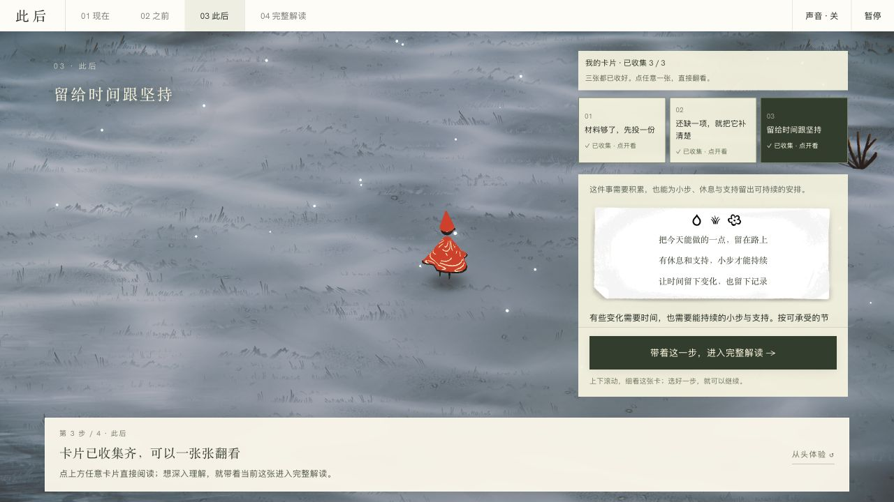
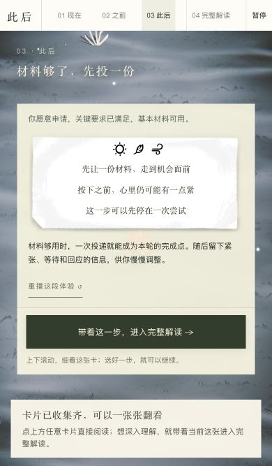

# 演示与截图

当前演示为 **「此后」V21**：现在 → 之前 → 此后 → 完整解读。以下是实际浏览器截图，使用合成求职材料，没有对应的真实咨询者。画面中的原作素材来自 [Wayfinder](https://wayfinder.nfb.ca/)，具体权属见[来源说明](../afei-destiny-skill/assets/cihou/quiet/wayfinder/PROVENANCE.md)。

[下载完整 HTML](https://github.com/guojiahh/afei-destiny-skill/raw/refs/heads/main/design-demos/cihou-wayfinder-v21/final_report.html) · [查看构建资料](../design-demos/cihou-wayfinder-v21/README.md) · [返回项目首页](../README.md)

## 一次体验怎样展开

### 1. 现在：按住看循环，松开停下来

按住画面或底部按钮，人物沿固定路线行走；键盘也可长按空格。沿路六句反复出现，帮助读者看到“触发 → 解释 → 应对 → 暂时作用 → 后续代价 → 再次回到”。点击“读懂路上这句话”会停下来展开解释，收起后可以继续。


走过本景短句并松开后，下一步按钮会突出。点“接着看 · 之前”，以同样的按住操作回看一种应对可能怎样形成。顶部导航始终可用，也可以直接阅读。

### 2. 此后：选一个，就收到一张卡

点一个待收集选择，会自动换场并完成一段有限体验，随后留下对应卡片；不用再次确认或继续长按。得到第一张就能进入正文，其余两张可以稍后收集。


这个求职演示有三种反馈，正式报告会按每个人的资料重写：

| 选择 | 体验侧重 | 卡片帮助读者带走什么 |
|---|---|---|
| 材料够了，先投一份 | 向外迈出一小步 | 允许一次尝试成为本轮完成点，再观察反馈 |
| 还缺一项，就把它补清楚 | 有限、具体的准备 | 识别一个真实缺口，为准备设置可完成的边界 |
| 留给时间跟坚持 | 有支持的持续 | 安排小步、休息与支持，记录并调整节奏 |

### 3. 收集后：点卡直接看，不必重过动画

三项显示各自收集状态。点已得卡直接切换短句与结果；只有明确点“重播这段体验”才再次播放。切章和从头体验会保留本页卡片，刷新页面后重置。



### 4. 完整解读：带着自己的选择深入读

点“带着这一步，进入完整解读”，正文保留当前选择摘要，并提供九章目录、技术依据与双底稿下载。关闭阅读会回到原卡片。


手机窄屏上，卡片内容可滚动，进入正文的按钮保持可见：

<p align="center"></p>

## 本地打开

**只看演示：** 下载上方完整 HTML，保存后用现代浏览器打开。约 68 MB 的文件包含原资源和内容，首次加载需稍等。GitHub 的文件页只展示源码，不运行页面。

**已克隆仓库：** 在仓库根目录启动仅服务匿名演示目录的本地服务器：

```sh
python3 -m http.server 8785 --bind 127.0.0.1 --directory design-demos/cihou-wayfinder-v21
```

浏览器打开 [本地演示](http://127.0.0.1:8785/final_report.html)。Windows 用 `python`；结束时在终端按 `Ctrl+C`。不要将包含私人咨询的目录作为公开服务器根目录。

也可以直接用现代浏览器打开本地 `design-demos/cihou-wayfinder-v21/final_report.html`。原作素材的权属见[第三方说明](../afei-destiny-skill/THIRD_PARTY_NOTICES.md)。

想重建时运行：

```sh
python3 design-demos/cihou-wayfinder-v21/build_demo.py
python3 design-demos/cihou-wayfinder-v21/build_demo.py --check
```

构建脚本使用正式渲染器和合成双底稿。旧版设计与 V15 内容构建依赖保留，详见[设计索引](../design-demos/README.md)。完整自动回归与浏览器证据见 [V21 QA](../design-demos/cihou-wayfinder-v21/QA.md) 和[逐张收集验收](../design-demos/cihou-wayfinder-v21/QA-COLLECTION.md)。

## 展示与真实使用的区别

本页展示的是产品交互和阅读方式。正式个人报告需从本次会话的有效资料、分析和来源计划生成，不能为演示换名后交付。当前没有在线账号、跨设备收藏或私有托管服务。

如要展示计算能力，从仓库根目录运行：

```sh
python3 afei-destiny-skill/scripts/calculate_bazi.py --date 1990-05-15 --time 14:30 --gender female --target-year 2026 --compact
```

结果四柱为 `庚午 辛巳 庚辰 癸未`。这只证明计算命例可复核，不能代替对解释与建议的验证。[安装并开始自己的探索 →](../afei-destiny-skill/README.md)
